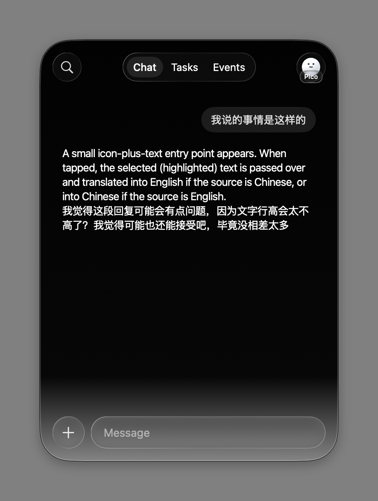
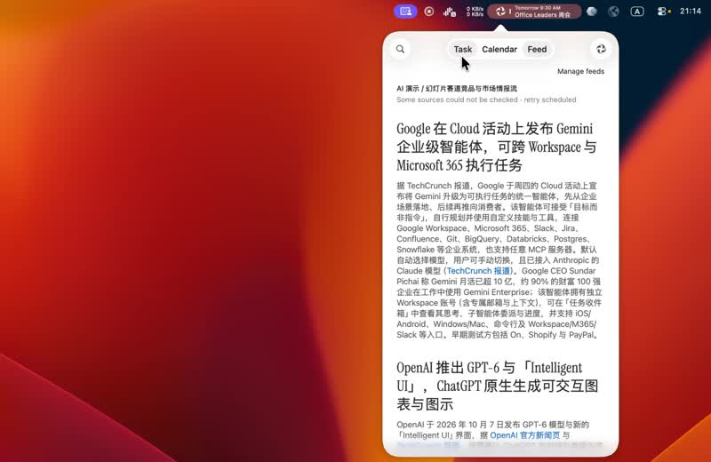
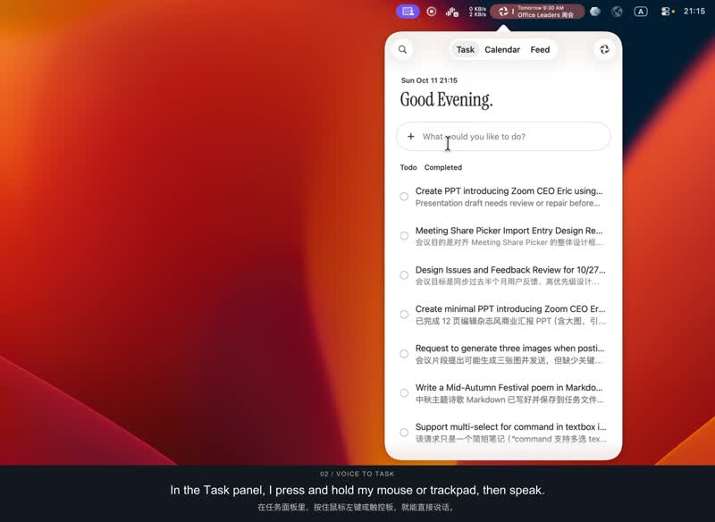
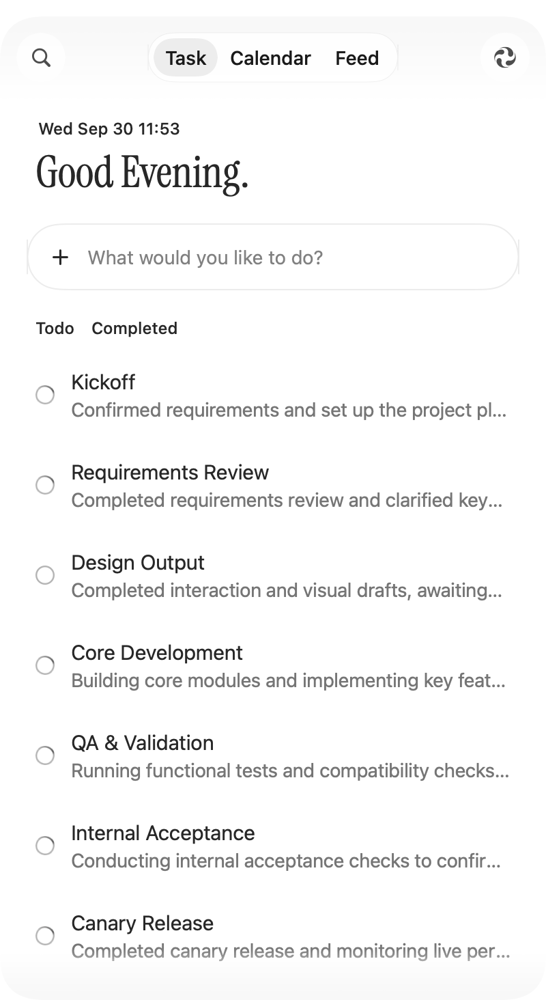
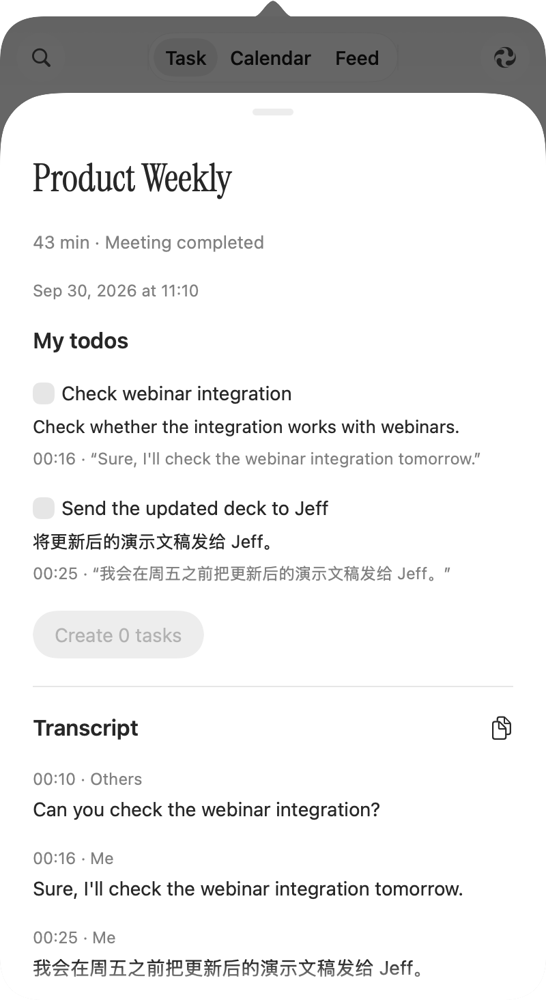
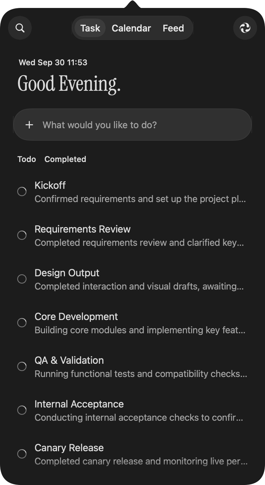

# Pico

**把一句话，变成可以推进的任务。**

Pico 是一个原生 macOS personal agent。你可以在 Chat 持续聊天、附上文件，让 Agent 研究信息、生成内容或操作 Mac；也可以在 Task 中管理任务并继续追加要求。Events 直接从 Zoom 同步未来七天的日程。点击菜单栏入口打开独立的深色窗口，窗口可以拖动、调整尺寸，并保持在其他应用前面。

界面使用 SwiftUI / AppKit，任务执行由 Hermes Agent 与 DeepSeek 驱动，Mac 应用操作接入 macOS Harness。

## 最近更新 · 2026-10-21

- **Zoom 账号与文档：**在 Settings → Zoom 连接本机 DevHelper 已登录的账号，Chat 和 Tasks 可查询有权限的会议、聊天、文档等信息，也可新建、编辑和重命名 Zoom Docs。[连接、权限与分发说明](docs/ZOOM-CONNECTION.md)。

- **统一品牌 Pico：**应用包、权限提示、设置文案和 Agent 身份统一使用 Pico。既有任务、会议、API 配置和系统权限标识继续复用。
- **独立窗口：**菜单栏图标作为入口，打开可移动、可调整尺寸的深色窗口。
- **Chat / Tasks / Events：**新增持续对话 Chat，Task 保留任务管理与执行，Calendar 改名 Events；移除 Feed 标签。
- **长期对话：**聊天记录在本机持续保存，发送给模型的上下文有界处理；滚离最新消息后出现返回底部按钮。
- **Pico 设置入口：**使用实时 3D 形象及产品名称，保留鼠标交互。

### 此前更新 · 2026-10-12—19

- **Pico 会议讲稿与演示（试用）：**导入并编辑分段讲稿，配对 Zoom Slides，按声音实际播完的进度共享、翻页；支持插话问答、暂停续讲、语言切换和本人接管。明确道别后可按会前设置离会。[配置与验证范围](docs/PICO-PRESENTATIONS.md)。
- **iPhone 镜像控制：**升级 Hermes Agent 至 v0.22.0，接入 phone-harness；修复中文联系人识别与微信搜索误选，改为按精确应用和联系人文字定位。
- **划词翻译与响应：**跨应用选中文字后可翻译并继续追问；修复长对话、连续操作确认引发的详情页卡死，执行结果按轮次保存并支持重启恢复。
- **Pico 桌面伙伴：**按住说话、拖动摆放、右键设置。支持经典 Pico、粉色花朵和默认白气球三种皮肤；表情更丰富，脸会根据摆放位置轻轻望向屏幕中心。[Pico 源码与运行说明](Pico/README.md)。
- **更省心的语音输入：**在 Pico Settings 保存一次百炼配置，主应用与桌面语音伙伴共用；支持中英文混说，自动插入文字时不再弹出 ⌘V 提示。
- **长文与日程：**改善长消息输入和详情页的响应；菜单栏日程改为上下两行，最多 320 点并随空间收窄。
- **录屏与执行：**加入屏幕、窗口及区域录屏；文字和语音任务默认自动执行，也可在 Settings 切回逐项确认。
- **会议能力：**加入百炼双通道会议转写、会前材料和试用中的 Pico 会议代理。实际会议、音频设备与云端服务仍需单独配置和验证。

已有介绍视频保留在下方。最近的代码、配置与构建变化见 [更新记录](docs/CHANGELOG.md)。

> 开发构建与发行构建分开管理。自包含的 Apple Silicon 测试版安装包通过 [GitHub Releases](https://github.com/cellier/Telos/releases) 分发；是否已有成功产物请查看对应 Release。测试版要求 macOS 26，未经过 Developer ID 签名或 Apple 公证。详细安装说明见 [发行说明](docs/RELEASE.md)。

## 新版 Chat 窗口

来自 Pico 0.6 开发版的真实原生窗口截图，使用设计稿演示对话；不含个人聊天记录。窗口可移动和缩放，3D Pico 会跟随鼠标。



## 旧版介绍视频

以下视频录制于改名前，演示了当时的任务、语音输入、日历、信息流和快捷键显示。当前版本以 Chat、Task、Events 为入口，旧视频不代表新版布局。点击封面或下方链接打开视频；如 GitHub 未提供在线播放，可在视频页面点击 **Download raw file** 下载观看。

| 中文原声 · 中文字幕 | English narration · 中英双语字幕 |
| --- | --- |
| [](docs/videos/telos-intro-zh.mp4) | [](docs/videos/telos-intro-en-bilingual.mp4) |
| [观看 / 下载中文视频](docs/videos/telos-intro-zh.mp4) | [Watch / download English video](docs/videos/telos-intro-en-bilingual.mp4) |

字幕下载：[原声中文字幕](docs/videos/telos-intro-zh-original.srt) · [英文字幕](docs/videos/telos-intro-en.srt) · [中英双语字幕](docs/videos/telos-intro-bilingual.srt) · [中文翻译字幕](docs/videos/telos-intro-zh-translated.srt)。另附[英文配音稿](docs/videos/telos-intro-narration.txt)。

视频录制于 2026 年 10 月，展示当时的开发版；具体功能和实验性功能的限制以下文为准。

## 历史界面预览

以下旧版图片保留用于工程参考；新版独立窗口以最新 Figma 设计为准。图片来自真实应用的隔离预览模式，使用代码内置的示例任务、日程和会议片段，**不包含用户的真实任务或会议记录**。示例日期、问候语和日程仅用于展示布局；截图不代表外部操作或真实会议已完成端到端验证。

<table>
  <tr>
    <td align="center"><strong>Task · 从目标开始</strong></td>
    <td align="center"><strong>Calendar · Next 7 days.</strong></td>
  </tr>
  <tr>
    <td></td>
    <td></td>
  </tr>
  <tr>
    <td align="center"><strong>Meeting → Transcript → Todo</strong></td>
    <td align="center"><strong>跟随系统的深色模式</strong></td>
  </tr>
  <tr>
    <td></td>
    <td></td>
  </tr>
</table>

### Pico · 换个模样，还是同一个伙伴

以下是实时 3D 模型的原生渲染，三种皮肤共享按住说话、拖动、表情回应与任务入口。白气球为默认皮肤，右键可以切换。

| 经典 Pico | 粉色花朵 | 白气球 · 默认 |
| --- | --- | --- |
|  |  |  |

## 能用 Pico 做什么

### Chat · 持续对话

Chat 是独立于任务列表的 personal agent 对话入口。它复用任务执行引擎、工具、附件和配置；完整对话保存在本机。长历史采用有界上下文和摘要处理，避免把全部历史反复交给模型。向上阅读后可用返回最新消息按钮回到底部，按钮随滚动状态以弹簧缩放动画显示或隐藏。

### Task · 任务与持续对话

- 用自然语言创建任务，自动生成英文任务标题。
- 在任务详情继续追问、调整要求，保留该任务的对话与产物。
- 粘贴或拖入图片、文件；点击 `+` 打开系统文件选择器。
- 输入框中的附件可以移除，也可以通过键盘删除；单个附件上限为 50 MB。
- 点击 checkbox 完成任务，在 Completed 中按完成日期查看。
- 让 Agent 从当前对话创建新的首页任务；每次用户请求最多创建 5 个。
- 搜索任务和日程；再次点击搜索图标可关闭搜索。

例如：

> 调研三个演示文稿工具，比较协作和导出能力，给我一份有来源链接的报告。
>
> 把这个文件整理成可编辑的 Excel 表格。
>
> 基于当前讨论，在首页创建三个后续任务。

### 录屏

按 **Option+R** 打开录屏工具（需要 macOS 15 及以上和“屏幕录制”权限）。直接点击录制整块屏幕，按 **空格** 后点击窗口录制该窗口，按住拖拽录制自选区域，**Esc** 退出。选好后，液态玻璃工具栏出现在选区正中：麦克风、摄像头可选择具体设备，系统声音可开关，三者默认关闭；点击 **Start Recording**（或回车）开始。录制中的停止横条显示时长、可拖动，且不会被录进视频；打开摄像头时会在选区左下角显示可拖动的圆形画面，并被一起录入。点击停止后，视频以录制开始时间命名（如 `2026-10-14 15.30.12.mp4`）保存到 `~/Documents/Pico/Recordings` 并复制到剪贴板。录制中再按 Option+R 也会停止。光标在文本输入框中时，Option+R 仍输入 ®，不会唤起录屏。

### 截图后本地改图（开发版实验功能）

按 **Option+A** 截图，macOS 26 及以上默认进入 **PaperKit 标注**。顶部工具栏支持画笔、荧光笔、橡皮擦、文字、矩形、椭圆、箭头、对话框和星形；选择工具后可拖动对象、拖动边缘/四角控制点缩放（Shift 保持比例）、双击文字编辑，并可撤销/重做。画布右下角的 **− / 百分比 / +** 可缩放至适应尺寸的 25%–800%，点击百分比或按 **⌘0** 恢复适应窗口；支持触控板捏合、双指滚动平移和 **⌘+滚轮** 缩放。缩放不影响原图分辨率和导出位置。选中文字后，跟随对象的浮条提供颜色、Aa 和字号入口；Aa 弹出面板可调整粗体、斜体、下划线、字体、对齐、行距和列表。**Done** 菜单提供 **Copy Image**、**Save PNG** 和 **AI Edit**。当前 macOS 原生 PaperKit 远程视图存在输入问题，因此使用 AppKit 接收编辑手势，所有标注仍写入 PaperKit 模型，画布预览与导出统一调用 PaperKit 的绘制 API；没有静默降级到旧标注器。交互预览按对象缓存 PaperKit 图像，移动时仅更新显示位置，松手后再完成尺寸重绘；文字框蓝色边缘点调整宽度，绿色角点同步缩放字号和文本框。低于 macOS 26 会明确提示 PaperKit 不可用。

选择 **AI Edit → Local edit** 后，可输入修改指令，或在图上按住说话；生成后可撤销、继续修改、复制或保存。本地模式使用 FLUX.2 Klein 4B / 4-bit / mflux，截图与指令不上传。**Annotate** 保留原有标注功能，使用已配置的 AI 服务。

一次性安装（Apple Silicon、Python 3.12、uv）：

```sh
zsh scripts/setup-image-edit.sh
zsh scripts/build.sh
```

模型存放于 `.runtime/image-model`，运行环境为 `.runtime/image-venv`。下载固定版本后推理强制离线。此可选环境尚未纳入发布 DMG，当前在本机开发构建中可用。更新启动时不再主动重置系统权限；截图仍通过 macOS 正常授权流程获取屏幕录制权限。语音还需麦克风权限。原本地改图的模型性能验证见下表。PaperKit 更新已在本机验证系统截图进入编辑器、绘画、文字编辑和拖动、图形拖动与缩放、撤销重做、复制和 PNG 保存；本次没有重新运行完整的语音/AI 生成工作流。

独立 pipeline（不会覆盖输入）：

```sh
.runtime/image-venv/bin/python Backend/local_image_edit.py \
  --model-path .runtime/image-model \
  --input /absolute/path/screenshot.png \
  --instruction '把大标题改成红色，其他内容保持不变' \
  --output /absolute/path/edited.png
```

不传 `--input` 时作为 JSON-lines 常驻进程，逐行接收 `image`、`instruction`、`output`，返回 `stage` 或 `output` + `metrics`。窗口内复用权重，关闭或取消时终止进程。工作图约 1 MP、最长边 1536，按比例缩放并补边；输出恢复原始尺寸，但并非原始清晰度或像素保真。临时缓存限制 256 MiB；24 GiB 的 MLX memory limit 是分配器软限制，并非整个进程硬内存上限。

2026-10-01 本机实测（M5 Pro / 48 GB / macOS 26.7；mflux 0.20.0、MLX 0.32.2；其他日常应用仍打开）：

| 项目 | 观测 |
|---|---|
| 完整量化模型文件 | 4,619,704,367 bytes，4.62 GB / 4.30 GiB；下载约 4 分 48 秒 |
| Python 环境磁盘占用 | 约 1.1 GiB；不含共享 uv 缓存 |
| 800×1464 截图，内部 768×1392，4 steps | 首次 54.7 秒、同进程第二次 39.0 秒（各一次，非统计基准） |
| 应用内中文指令 | 38.7 秒；大标题成功变红 |
| MLX 峰值分配 | 14.37 GB（13.39 GiB）；不等同于整个系统内存 |
| 应用编辑进程 vmmap | physical footprint 峰值 11.7 GiB，编辑后空闲约 2.3 GiB；与 MLX 计量口径不同，不可相加 |
| 验证 | 实际推理、中文输入、PNG 保存（800×1464）、撤销恢复、取消并终止进程、Swift 构建及签名检查 |

质量边界：改标题颜色成功；另一条“仅 Task 标签背景变蓝”误改了整个页头。中英文细节会被重绘，不适合必须保留每个字和每个像素的精确编辑。未限制缓存的首次探索约 49/72 秒，并观察到系统 swap 大幅增长；限制缓存后复测如上，仍不能推断空载性能或整机内存需求。仅加箭头、说明时优先使用 Annotate。

本轮 FLUX Apple Silicon 编辑路径可运行，未实测 Qwen，因此没有两模型实测排名。Qwen-Image-2.1 是后续比较候选，而非静默回退路径。实现依据：[mflux FLUX.2 编辑说明](https://github.com/mflux-community/mflux/blob/main/src/mflux/models/flux2/README.md)、[量化模型](https://huggingface.co/Runpod/FLUX.2-klein-4B-mflux-4bit)。原始测试记录与图片仅存于本地忽略目录 `evidence/local-image-edit/`，不进入版本控制。

### 研究、文件与网页

Agent 的工具包括网页搜索、公开网页读取、天气查询、文档生成和本地网页制作。可生成 Markdown、CSV、PDF、Word、Excel、PowerPoint 等文件；网页可以使用 Playwright 在本地渲染、检查并打包。

生成文件统一保存在 `~/Documents/Pico`，可从 **Pico Settings → Generated Files → Open Files Folder** 打开。Task 和 Chat 的产物分别位于 `Tasks/<任务 ID>`、`Chats/<会话 ID>`，保留网页、PPT 等文件的资源目录；保存的截图位于 `Screenshots`，录屏位于 `Recordings`。已有任务和会话工作区会迁移到此处，历史消息中的旧文件链接继续可用。截图默认复制到剪贴板的行为保持不变，选择 **Save PNG** 时才写入截图文件夹。API 配置、聊天记录、日志和临时识别音频仍存放在内部数据目录。开发和测试使用独立的数据目录时，文件会保存到该目录内的 `PicoFiles`；可通过 `PICO_FILES_DIR` 显式指定输出根目录。

公开网页访问不等于可以读取所有登录页面；网站限制、网络状况和工具执行结果仍会影响任务。生成本地网页也不等于已经部署到公网：公开发布需要另外配置托管服务及相应授权。

### 操作 Mac

通过 macOS Harness，Pico 可以发现和打开应用、读取辅助功能界面、检查截图，并执行键盘、鼠标、AppleScript 或 Python 操作。

当前开发版默认开启 **Automatic execution／自动执行**：文字和语音任务使用同一规则，在你交代的任务范围内自动完成应用操作、脚本、技能安装，以及明确要求的发送或修改，无需逐步点击批准；操作结果保留在任务记录中。信息不足时才询问，你可以随时停止任务。在 Settings 关闭此开关可恢复逐项确认，修改对下一次任务或重试生效。Feed 保持仅收集和整理信息的独立模式。系统权限、登录或身份验证仍可能需要用户处理。

可用程度取决于目标应用、登录状态、系统权限以及应用是否暴露可操作的界面。Pico 的批准机制不是操作系统沙箱；脚本以当前 macOS 用户权限执行。

### 通过 iPhone 镜像操作手机

安装并启用官方目录中的 [phone-harness](https://hermes-agent.nousresearch.com/docs/plugins/phone-harness) 后，Pico 可通过 Mac 上的 **iPhone Mirroring／iPhone 镜像** 操作已连接的 iPhone。直接在普通任务中说明要在手机上完成什么；工具会先检查连接，再读取界面并执行。Feed 自动刷新不会得到手机控制工具。

iPhone 需要先在系统镜像应用中完成配对并保持可连接，Pico 需要辅助功能与屏幕录制权限。密码、PIN、双重验证码及系统认证由本人处理。手机操作沿用 Settings 的自动/手动执行设置，多个任务会轮流使用同一台手机，取消任务会终止对应脚本。手机截图用于模型理解界面时会随该任务发往已配置的模型服务；插件遥测关闭。本接入固定为本机 iPhone，不会自动租用云手机。

源码安装会自动准备固定版本；已有 Hermes v0.22.0 和 Python 3.14 的 Pico 开发环境可补装插件：

```sh
python3 scripts/runtime-phone.py
```

主环境必须是 Python 3.14。实际插件安装使用 `hermes plugins install phone-harness --yes-deps --enable`，通过 `HERMES_HOME` 定向到 Pico 自己的插件目录；只在其他 Hermes 目录里安装，不会自动接入 Pico。版本及完整提交固定在 `scripts/runtime-pins.json`。

### Gmail、Twitter/X、Notion 与 Figma

在 **Pico Settings → Connected Apps** 连接账号，在浏览器中由本人完成平台授权，再点该账号的 **Check connection** 核实。授权保存在 Pico 自己的 Hermes 环境中，Chat 和 Task 共用，不需要每个任务重新登录；不会复制 Codex 或其他客户端的凭据，也不会开放给 Feed 自动收集。

在聊天中直接说明要查找、创建或修改的内容。Pico 会先发现该账号当前提供的工具，再按实际权限执行；读取、写入和删除分开校验，外部修改沿用 Automatic execution 设置。服务没有提供的操作不会冒充已经支持，例如能读取 Figma 设计并不代表可以任意修改设计节点。写入后需回读结果，不确定的提交不会自动重发。连接入口和工具可用状态不等同于每项平台操作都已完成实测。

### Zoom · 账号信息与文档

在 Chat 或任务详情中直接说明要做的事，例如「新建一份 Zoom 文档，整理这次讨论」「在这份文档的结论后补充下一步」或「把文档重命名为项目周报」。可以提供文档链接，或让 Pico 先搜索并确认目标文档。

- 支持新建文档、追加内容、按指定段落编辑和重命名；未指定位置时，新文档创建在 My Docs。
- 编辑前读取目标内容并定位具体段落，写入后重新读取核对。只有服务返回的实际文档 ID 和链接可以作为交付结果；响应失败或写入结果不明确时，不会声称已保存成功。
- 沿用当前任务的自动执行／批准设置。Zoom 在每次操作时检查当前账号的权限，连接并不意味着能修改所有可见文档。
- 其他 Zoom 服务继续提供读取能力；此入口不开放文档分享、成员与所有权变更、删除或消息发送。Events 仍然只同步日程，不修改远程日历。

### Events · 未来七天

- 通过现有 Zoom 连接直接同步当前选中的可读日历，不再依赖 macOS 系统日历的同步缓存。需要先在 DevHelper 登录，并在 Pico 设置中连接 Zoom。
- 自动更新未来七天，展开重复日程，排除已取消或本人已拒绝的邀请；没有选中的共享日历不会混入列表。成功同步后替换旧数据，改期和删除也会反映在列表中。
- Events 与菜单栏使用同一份 Zoom 数据。临时同步失败不会覆盖上次成功的同账户数据；重新连接或更换账户会重新校验数据来源。
- 按日期分组，省略没有日程的日期；跨天事件会出现在对应日期。
- 菜单栏显示近期日程，在当天选择中优先显示有具体时间的日程。图标右侧分两行显示：上方为日期／时间，下方为日程名称，使用较小字体以显示更多内容。日程区域最多占 320 点，并根据屏幕和菜单栏位置自动收窄；长标题显示省略号，空间不足时仅保留 Pico 图标，悬停仍可查看完整日程名称。
- 这是日历读取与展示功能，不会通过 Events 页面创建、编辑或删除 Zoom 日程，也不会把日程发送给 AI。

### 旧版 Feed 数据

新版界面移除 Feed 标签；历史订阅、候选和已保存卡片继续保留在原数据目录，不会因改版删除。旧版独立采集服务可通过 `python3 scripts/feed-collector-service.py uninstall` 停止，历史数据仍保留。

### 会议 → 转录 → 待办（开发中）

会议功能目前以 Zoom 桌面应用为检测对象，需要 macOS 26 及相关权限。开启会议监测并准备语音模型后，Pico 会检测会议状态，将会议关联到任务，并区分本机麦克风与会议应用音频的转录来源。

中英文混说使用本地 Qwen ASR；选择受支持的单一语言时可使用 Apple 本地语音能力。转录保存后，DeepSeek 可以分析文字并提出带原文依据的待办建议。用户选择建议后才创建任务，一次最多 5 个，已创建的建议不会重复生成任务。

**验证边界：**仓库包含会议生命周期、恢复和任务创建测试，但不代表所有 Zoom 版本、耳机切换、音频设备和真实会议场景都已验证。检测、授权、音频捕获、转录和待办提取是不同环节，任一环节未就绪都会影响结果。

### 语音输入与截图

- **长按语音输入：**在可编辑输入框内按住鼠标左键，听到提示后说话，松开结束；支持中英文混说。已配置百炼账户时默认使用 `qwen-audio-3.1-asr-flash`，在 Pico Settings 中填写百炼 API Key、地域和业务空间，保存一次后重启继续使用，并直接插入识别结果；录音会发送至百炼并按用量计费。密钥不可用或云端失败时会提示并自动使用本机识别，恢复流程不经过 DeepSeek 整理。也可关闭百炼、始终使用本地识别。自动粘贴不会在快捷键显示中弹出 ⌘V，手动按键仍正常显示。跨应用插入依赖辅助功能能力，不保证适配所有自绘编辑器；只读文本与密码框不应触发。
- **区域截图：**按 `Option + A`，拖选区域，松开后复制到剪贴板。
- **窗口截图：**进入截图模式后按空格切换窗口选择，再点击目标窗口。
- 截图时可以保留 Pico 窗口，便于截取应用自身内容。快捷键可能与其他截图工具冲突。

### Soul、Memory 与 Skills

Settings 中可访问 **Soul, Memory & Skills**：编辑 Agent 的身份指令、查看或删除持久笔记、管理共享 Skills。Hermes 可以发现和读取 `SKILL.md`；持久记忆应在用户明确要求时保存。

Skill 是工作指令与资源，不会自动提供系统权限、账号访问或缺失依赖，也不能绕过操作审批。

## 独立窗口与菜单栏入口

点击菜单栏 Pico 图标打开或聚焦独立窗口。窗口可拖动、可调整尺寸，使用深色界面；Chat、Task、Events 随窗口宽高自适应。正在执行任务时，菜单栏 logo 顺时针旋转并间歇停顿，对应任务的 checkbox 边框显示活动状态。

首页展示本机日期时间与问候语；再次打开窗口保留阅读位置，双击 Task 可回到顶部。任务详情使用底部滑出的页面，可点击上方遮罩或下拉 handle 关闭。Settings 在应用窗口内部打开，新主窗口固定使用深色设计。

| 操作 | 快捷键或入口 |
| --- | --- |
| 新建任务输入 | `Command + N` |
| 搜索 | `Command + F` 或左上角搜索图标 |
| 关闭搜索／详情 | `Escape` |
| 截图 | `Option + A`；菜单栏图标右键菜单也有入口 |
| Settings | Pico 的 3D 形象与名称入口 |
| 演示按键显示 | Settings → Show keystrokes，默认开启 |
| 退出 | `Command + Q` 或菜单栏右键菜单 |

演示按键显示会在当前鼠标所在屏幕底部显示最近按下的键或快捷键（如 `⌘C`、`⇧Tab`、方向键），按住期间持续显示，松开所有键后约 1.6 秒消失；切换应用仍有效，显示层不拦截点击或抢走输入焦点。首次开启会申请 macOS 的 Input Monitoring／输入监控权限，授权后自动开始；设置中的开关会保留到下次启动。显示仅在本机内存中短暂存在，不保存、上传按键记录；系统安全输入或 Pico 密码输入期间暂停。

## 安装发行测试版

在 [Releases](https://github.com/cellier/Telos/releases) 下载 DMG，拖入 Applications 后打开，并在 Settings 填入自己的 DeepSeek Key。私有仓库的下载需要仓库访问权限。

发行包包含可随应用移动的 Python、Hermes、macOS Harness、Chromium 和本地中英文语音模型，不需要源码目录或开发工具。未公证测试版首次打开可能被系统阻止，见 [安装及限制](docs/RELEASE.md)。源码开发构建仍使用下述 `.runtime` 环境，两者不要混淆。

## 从源码运行

### 环境要求

| 项目 | 当前要求 |
| --- | --- |
| 硬件 | Apple Silicon Mac；现有构建目标为 `arm64` |
| macOS | 构建最低目标为 macOS 14；Liquid Glass 与会议功能需要 macOS 26，完整体验建议使用 macOS 26 |
| 编译工具 | Apple Command Line Tools；当前脚本使用 `/Library/Developer/CommandLineTools/SDKs/MacOSX26.5.sdk` |
| Python | Hermes 主环境使用 Python 3.14；本地语音环境保持 Python 3.12，由 `uv` 创建 |
| 依赖工具 | Git、[uv](https://docs.astral.sh/uv/) |
| 模型服务 | 可用的 DeepSeek API Key；任务执行与模型整理需要网络 |

构建脚本优先使用本机验证过的 SDK，找不到时使用当前 Xcode / Command Line Tools 的 SDK；也可通过 `TELOS_SDK` 指定。最低部署版本不等于已经在所有旧版本系统上完成验证。

### 1. 获取源码

```sh
git clone git@github.com:cellier/Telos.git
cd Telos
```

仓库当前为私有，需要相应 GitHub 权限。也可以使用已经配置凭据的 HTTPS 克隆方式。

### 2. 安装依赖并构建

```sh
# 使用已配置的稳定签名身份；替换成自己的 codesign 身份名称或指纹。
TELOS_CODESIGN_IDENTITY='Apple Development: Your Name (TEAMID)' ./scripts/setup.sh

# 仅临时试用源码时，也可明确选择 ad-hoc 签名。
# TELOS_CODESIGN_IDENTITY=- ./scripts/setup.sh
```

该脚本会：

1. 下载固定提交版本的 Hermes Agent 与 macOS Harness。
2. 创建 `.runtime/venv` 并安装后端依赖。
3. 安装 Playwright Chromium。
4. 通过隐藏输入提示配置 DeepSeek Key；已有本地配置时保留原配置。
5. 构建 `build/Pico.app`，使用明确指定或此前已配置的本机签名身份。

构建不会创建钥匙串、导入证书或修改系统信任。没有签名配置时会报错；持续使用建议沿用同一稳定身份，临时 ad-hoc 构建更新后可能需要重新授权。后续构建也应保留同样的 `TELOS_CODESIGN_IDENTITY` 设置，或使用已有的本机签名配置。

### 3. 安装可选的本地语音环境

需要语音输入或中英文混合会议转录时运行：

```sh
./scripts/setup-speech.sh
```

脚本创建 `.runtime/speech-venv`，安装 `mlx-audio==0.5.6` 并下载 `mlx-community/Qwen3-ASR-0.6B-4bit`。首次准备模型需要网络、磁盘空间和一定时间。

### 4. 打开应用

```sh
open build/Pico.app
```

Pico 的菜单栏图标用于打开或聚焦独立窗口。后续只修改源码时，可重新构建：

```sh
TELOS_CODESIGN_IDENTITY='Apple Development: Your Name (TEAMID)' ./scripts/build.sh
open build/Pico.app
```

重新构建后应先退出旧进程，再打开新版本。当前 `.app` 包含指向此 checkout 下 Python 环境的路径，**不要只复制 `.app` 到另一台电脑，也不要随意移动或删除源码目录**。这不是自包含安装包。

## API 配置与系统权限

DeepSeek Key 可通过首次安装提示或 Settings 中的输入框配置，保存在本机（为保留既有配置，目录名称继续沿用兼容路径）：

```text
~/Library/Application Support/Telos/config.json
```

默认服务地址为 `https://api.deepseek.com`，当前默认模型标识为 `deepseek-flash`。实际可用模型与账号服务能力以服务端为准。仓库不包含可用密钥；不要把真实配置复制进提交。

| 权限 | 用途 |
| --- | --- |
| Accessibility／辅助功能 | 读取和操作 Mac 应用、跨应用语音输入、Zoom 状态检测 |
| Input Monitoring／输入监控 | 跨应用显示演示按键，仅监听，不拦截或改变按键 |
| Screen Recording／屏幕录制 | 截图、屏幕观察及会议应用音频捕获 |
| Microphone／麦克风 | 语音输入与会议中的本人音频 |
| Zoom 连接 | 直接读取未来七天日程；不需要 macOS 日历完整访问权限 |
| Automation／自动化 | 系统按目标应用分别请求的 Apple Events 授权 |
| Speech Recognition／语音识别 | 使用 Apple 语音路径时按系统要求授权 |

在 Settings 中检查权限状态；如果系统要求手动添加应用，可以使用 **Show Pico in Finder** 定位当前构建。权限开启后可能需要重启应用。

**当前开发版更新行为：**更新不会主动重置已有系统授权，本机构建使用稳定签名延续权限身份。从系统设置返回 Pico Settings 时会自动重新检查权限；macOS 要求的首次授权仍需用户确认。

## 数据、隐私与批准范围

为兼容旧版安装，bundle ID 继续使用 `com.telos.mac`，内部 `TELOS_*` 环境变量、偏好 key 和工具协议保持不变；这些标识不用于产品展示。主要应用数据位于 `~/Library/Application Support/Telos/`，包含任务记录、附件、会话历史、Feed、记忆与会议转录。任务工作目录按任务隔离。API 配置采用本地文件保存及访问权限限制，**不是 Keychain 加密存储**。

| 数据 | 处理方式 |
| --- | --- |
| 任务文字、工具结果、相关应用文本 | 执行任务时可能发送到 DeepSeek |
| 任务需要的截图或图片内容 | 按具体工具和模型能力处理，可能发送到模型服务 |
| 语音识别 | 本地模式在本机识别；开启百炼时录音发送至百炼。Pico 长按输入的云端失败会提示并恢复本地识别 |
| 会议待办分析 | 使用转录文字调用 DeepSeek；本地识别不等于分析也完全离线 |
| 网页搜索与 Feed | 会访问搜索服务和对应内容来源 |
| Mac 操作执行 | 文字和语音默认自动执行；可切换手动批准。取消或目标状态变化仍会阻止继续操作 |

本地任务数据不会因为提交代码而自动上传到 GitHub。`.gitignore` 排除了运行环境、构建产物、日志、验证记录和常见本地配置文件；产品截图单独存放于 `docs/images/`。

## 项目结构与技术栈

```text
Sources/                 SwiftUI / AppKit 界面、状态管理和原生系统集成
Backend/                 Hermes 执行、Mac 工具、Feed、语音整理与会议分析
Pico/                    桌面语音伙伴、三种实时 3D 皮肤和交互测试
Resources/               应用内字体、图标及预览资源
assets/                  应用图标源资源
scripts/                 安装、构建和本地配置脚本
tests/                   Swift 与 Python 回归测试
docs/images/             README 产品截图（示例数据）
.runtime/                本地 Python 环境及引擎源码，不提交
build/                   本地应用构建结果，不提交
```

- **界面：**SwiftUI、AppKit、SF 系统字体、SF Symbols、Instrument Serif。
- **Agent：**[Hermes Agent](https://github.com/NousResearch/hermes-agent)，v0.22.0，固定提交 `e06df9c2eae6901f4c88f464e0ae6e753c0428b8`。
- **Mac 控制：**[macOS Harness](https://github.com/browser-use/macos-harness)，固定提交 `b88e4d77403bbcac35752eef4f4dd72db3663fd6`。
- **系统集成：**Zoom Calendar、ScreenCaptureKit、AVFoundation、Speech、Accessibility。
- **文档与网页：**python-docx、openpyxl、python-pptx、ReportLab、PyMuPDF、Playwright 等，版本见 `Backend/requirements.txt`。

## 开发与验证

Python 后端测试：

```sh
.runtime/venv/bin/python -m unittest discover -s tests
```

Swift 测试是独立入口，按需编译运行。例如检查窗口动画与滚动位置：

```sh
swiftc -D TELOS_TEST \
  -sdk /Library/Developer/CommandLineTools/SDKs/MacOSX26.5.sdk \
  -target arm64-apple-macos14.0 -swift-version 5 -parse-as-library \
  Sources/*.swift tests/PanelScrollTests.swift \
  -o /tmp/telos-panel-tests \
  -framework SwiftUI -framework AppKit -framework CoreText

TELOS_PREVIEW=list TELOS_PREVIEW_PIN=1 \
TELOS_DATA_DIR="$(mktemp -d /tmp/telos-test.XXXXXX)" \
/tmp/telos-panel-tests
```

原生 UI 测试需要 macOS 图形会话。不同测试有各自的数据与运行要求，不应把预览参数机械地加到所有测试上，也不要对个人真实数据目录运行测试。

生成隔离产品预览：

```sh
TELOS_PREVIEW=list TELOS_PREVIEW_APPEARANCE=light \
TELOS_PREVIEW_ANCHOR=0.5 TELOS_SNAPSHOT=/tmp/telos-home.png \
TELOS_DATA_DIR="$(mktemp -d /tmp/telos-preview.XXXXXX)" \
build/Pico.app/Contents/MacOS/Pico
```

可用预览包括 `list`、`detail`、`calendar`、`meeting`、`meeting-live`、`settings`、`completed`、`search` 等。预览用于界面检查，不能代替真实工具执行、权限验证或真实会议测试。

## 常见问题

**怎样打开应用窗口？**
点击菜单栏 Pico 图标打开或聚焦独立窗口。右键图标可打开设置、截图或退出。

**为什么 Agent 无法执行某些操作？**  
先检查 API 配置、网络、目标应用登录情况，以及具体工具所需的权限。网页打开和本地文件生成与辅助功能授权是不同能力；权限显示 Ready 也不代表所有应用都能被可靠操作。

**为什么会议开始后没有反应？**  
在 Settings 检查会议监测开关、权限和语音模型准备状态；当前只实现 Zoom 检测路径。检测到会议、开始捕获音频、出现转录文字和生成建议分别需要验证。

**为什么语音输入没有把文字放进其他应用？**  
目标必须是可编辑输入框，并允许辅助功能访问。密码框、只读文本、特殊自绘编辑器可能不支持；也应检查本地语音环境和麦克风授权。

**能直接把构建包发给别人吗？**  
请使用 Releases 中通过打包检查的 DMG；`scripts/build.sh` 单独生成的开发包仍依赖 checkout。发行测试版尚未公证，也没有覆盖所有硬件和真实会议场景。不要在发行包中携带个人 API Key 或用户数据。

## 当前边界

尚未提供跨设备同步、App Store 发行、经过 Apple 公证的安装包、通用的公网网站发布服务或所有会议应用的支持。日常 Agent 推理依赖配置的 DeepSeek 服务，不能因为存在本地语音模型就视为完全离线应用。

仓库中的测试与预览是开发验证的一部分；真实 Mac 操作、外部发送、复杂网站访问和会议音频能力仍应以实际执行结果为准。

## 字体与第三方许可

Instrument Serif 随项目附带，其 SIL Open Font License 见 [Resources/OFL.txt](Resources/OFL.txt)。其他第三方依赖遵循各自许可证。仓库目前没有为 Pico 自身声明开源许可证；GitHub 上可见或可克隆不等于获得任意再分发授权。

## 构建与发布 DMG

```sh
./scripts/release/prepare.sh
python3 scripts/release/package.py
```

安装包与 SHA-256 校验文件写入 `dist/`，不会提交到源码仓库。打包检查涵盖运行路径、外部符号链接、动态库依赖、干净用户目录下的核心导入、Chromium、本地语音模型及开发者 API Key 排除。该检查不替代真实硬件和权限验证。

推送 `v*-preview.*` 标签会触发 `.github/workflows/release.yml`，在 GitHub 的 Apple Silicon macOS runner 上重建、检查并发布预发行版。工作流使用 GitHub 自动提供的令牌，权限限定在仓库内容；不需要存放个人 GitHub Token 或 DeepSeek Key。构建可能消耗私有仓库的 Actions 配额。

### Todo automatic approval

Todo runs launched by the native app automatically approve Pico tool actions, scripts and work plans. Each automatic decision is recorded in the task conversation. Feed refreshes retain their existing restricted tool set and interactive approval policy. Stop still terminates the worker and its children; current-target validation and result verification remain enabled. macOS permission and authentication dialogs are handled by the operating system. Existing in-flight runs keep their original policy until restarted.

### Professional presentations

Todo presentation requests use the bundled `telos-presentations` skill and four dedicated tools: `presentation_guide`, `create_presentation`, `review_presentation`, and `finalize_presentation`. The old `.pptx` branch of `create_office_file` routes through the same draft workflow. A brief, requested total count and per-slide purpose precede design. Nine editable compositions cover cover/closing, statement, points, comparison, metrics, native charts/tables and sourced images, with executive/editorial/scientific themes and optional brand colors.

The builder uses the installed document runtime's Artifact Tool, validates the exported OOXML package, imports it back, renders every slide, and verifies native objects. The configured vision provider reviews every slide and the narrative. Finalization requires all reviews to pass for the same unchanged draft. Runtime/reviewer failures remain explicit draft limitations. This does not establish that cited facts are true or that a file has been tested in PowerPoint. Strict preservation of an uploaded template requires a separate source-preserving editing workflow.

Run `python3 scripts/configure-presentations.py` after installing/moving the local document runtime, then rebuild. This locates existing dependencies without modifying or vendoring their packages; the current desktop setup depends on the installed Presentations runtime. For verification: `python -m unittest discover -s tests -p 'test_presentations.py'`. Public design-workflow references: [Anthropic pptx](https://github.com/anthropics/skills/tree/main/skills/pptx) and [OpenAI Slides workflow mirrored by JetBrains](https://github.com/JetBrains/skills/tree/main/slides). Pico ships its own instructions and code, not copied third-party skill implementations.


### Prompt-driven presentation styles

The bundled user-supplied library contains 155 style references (84 structured and 71 image-native), including their original visual specifications and 950 preview images. `presentation_styles` uses the actual audience, purpose and aesthetic prompt to recommend three real catalog entries and automatically resolve the best one by default. When the user asks to compare options, recommendation mode exposes three preview artifacts and waits for a choice. An explicit stable style ID is honored.

A resolved style is required before generation. The renderer applies its palette, heading family, text scale, spacing, alignment, accent rules and composition; visual review sees both generated slides and the style reference. Contrast is checked when adapting text colors. References requiring photography, collage, custom illustration or exact typography still require real assets/custom design; selecting a reference does not promise pixel-identical reproduction of all 155 styles. Source attribution is preserved in `Backend/style_library/SOURCE.md`. Original files on the Desktop are unchanged.


PPT imagery uses `presentation_assets` for bounded image search, primary-page image discovery, downloaded/user-supplied image verification, and SVG logo conversion. Each selected asset retains its source page, pixel dimensions, hash and actual visual-review verdict. Photos use the image/cover/closing layouts; optional logos are embedded proportionally in a consistent footer. Builds reject unverified or changed assets, exact duplicates, resized/recompressed duplicates and common center/corner crops. Verified brand logos may repeat as branding. Similarity detection is conservative rather than a guarantee for arbitrary transformations. Final per-slide review also checks relevance, wrong branding, watermarking and visual fit. Search failures fall back to source-page discovery and remain explicit if unresolved.

### Pico 语音伙伴

Pico 是桌面语音入口。按住说话，松手后识别并交给 Pico 执行。支持拖动摆放、右键切换三种皮肤，白气球为默认；脸部只轻轻朝向所在屏幕的中心，保留鼠标靠近和点击时的表情回应。构建与交互说明见 [Pico/README.md](Pico/README.md)。

在 **Pico Settings → Bailian API Key** 保存一次地域、业务空间与密钥，桌面伙伴的云端识别和回复朗读会读取同一份本机配置，重启后继续使用。Pico 的「Voice settings」控制百炼识别与朗读开关；识别模型为 `qwen-audio-3.1-asr-flash`，附带中文、英文提示及 Pico、Zoom 等产品名热词。只有尚未保存 Pico 配置时才兼容读取旧钥匙串账户，不会为此弹出授权窗口。

开启云端识别时，按住期间的录音会发送至阿里云百炼，按服务用量计费；关闭后使用 Pico 本地 `Qwen3-ASR-0.6B-4bit`。云端失败会提示并将保留的录音交给 Pico 本地识别；取消时丢弃迟到结果并清理临时录音。语音设置中的混读测试使用固定合成测试音频，不会创建任务。Pico 长按输入会在百炼失败时明确提示并恢复到本地识别；Pico 独立 App 的语音设置与 Pico 会议转写各自保留原来的错误处理。

### Pico 会议代理（本地 Zoom 客户端，试用）

Pico 菜单的「会议代理…」或 Pico 的 Meeting Setup 可打开独立控制窗口。首次目标是轻松的 1on1：使用现有百炼账户的 `qwen-audio-3.1-realtime-plus` 听取 Zoom 对方音频并生成回复，首次回复说明 AI 代理身份。无 Zoom SDK、开发者账号或自动加入会议；由用户在已经加入的目标会议中启动。

会前也可配对 Zoom Slides 和分段讲稿，导入后编辑开场、每页内容、等待回答和结尾；讲解中支持插话、暂停续讲、中英文切换、回看页面，以及明确道别后的会议收尾。[讲稿示例、操作与验证范围](docs/PICO-PRESENTATIONS.md)。

音频桥使用官方 BlackHole 2ch 驱动。Zoom 的麦克风选择 BlackHole、扬声器选择耳机；控制窗口选择实际麦克风。代理工作时仅代理语音进入 BlackHole；点击 Take over 或按 Control–Option–Space，会在本机先清空代理音频并切到实际麦克风，然后取消网络请求。网络失败也交还控制。结束会话后麦克风桥暂时保持，避免 Zoom 突然无声；把 Zoom 麦克风切回实际设备后，再断开音频桥。退出 Pico 会停止音频桥。

对方语音和会前背景会发送至百炼。聊天记录保存在 Application Support/Telos/pico-meetings，结束后生成 Pico 交接记录；摘要沿用已配置的 DeepSeek。生成的代理回复、被打断的回复不作为用户承诺证据。接管后的人声不进入代理记录；若开启自动会议转写，则由其独立保存。应用关闭后恢复的原始代理记录不会冒充完整会议。

### 百炼会议转写

Meeting Setup 的独立开关控制 `qwen-audio-3.1-asr-flash-streaming`。使用 Pico Settings 中保存的百炼账户（尚未配置时兼容原 Pico 账户），双方独立实时流、句级时间戳、中英语言提示、临时热词；中间结果被最终结果替换。录音不落盘，转写在本机保存；云端按用量计费。网络、模型或积压错误会明确停止并标记缺失，绝不静默切换本地模型。关闭后保留原来的 Apple / Local Qwen 识别。

验证记录：`build/pico-meeting-work/cloud-check-next.json` 保存同一合成中英样本在百炼和本地模型上的实际输出。两者在此样本都正确，不能据此声称百炼总体准确率更高。重启后 BlackHole 已生效；`audio-route-second.json` 记录本机真实回环：代理测试音、打断清空、迟到帧拒绝、实际麦克风桥接、断开静音均通过。测试只保存信号统计，不录音、不上传。控制器故障与会后交接另有受控测试；真实 Zoom 对端听感、长时间稳定性和实际 1on1 聊天仍需用户指定的首场试聊。
